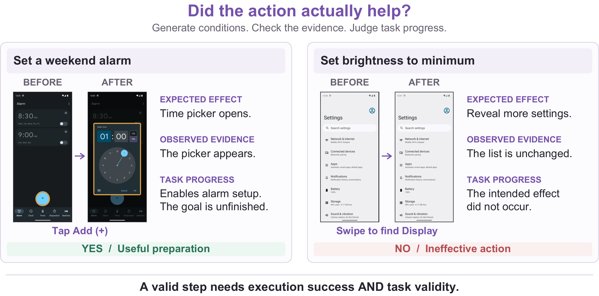

<h1 align="center">Q-Reflector</h1>

<p align="center"><b>Learning GUI Action Reflection with Generated Conditions</b></p>

<p align="center">
  Linqiang Guo<sup>1,2</sup> · Wei Liu<sup>1</sup> · Li Gu<sup>1,2</sup> · Yang Wang<sup>1,2</sup> · Tse-Hsun (Peter) Chen<sup>1,2</sup><br>
  <sup>1</sup> Concordia University &nbsp; <sup>2</sup> Mila – Québec AI Institute
</p>

<p align="center">
  <a href="https://arxiv.org/abs/2608.05587"></a>
  <a href="https://huggingface.co/spaces/pockyitachi/Q-Reflector"></a>
  
</p>

<p align="center">
  <a href="#overview">Overview</a> ·
  <a href="#demo">Demo</a> ·
  <a href="#quickstart">Quickstart</a> ·
  <a href="#training-and-evaluation">Training &amp; Evaluation</a> ·
  <a href="#data-and-models">Data &amp; Models</a> ·
  <a href="#citation">Citation</a>
</p>

<p align="center">
  
</p>

## Overview

**Did the action execute correctly, and did it help the user’s task?**
Q-Reflector is a vision-language verifier for mobile GUI agents. Given a task,
an action, recent action history, and screenshots taken before and after the
action, it generates conditions for a valid transition, checks the visual
evidence, and returns a structured explanation with a **Yes/No** verdict.

A useful intermediate step can be correct even when the overall task is
unfinished. Opening a time picker helps set an alarm; a swipe that fails to
reveal the intended settings does not.

- **Generated conditions.** State what must hold before the action and what its
  local effect should be, then evaluate the observed transition.
- **Actionable feedback.** A failed step produces evidence-based feedback for the
  host agent’s next action. Successful steps continue without a failure hint.
- **Agent integration.** The included MobileWorld implementation supports
  reflection feedback for MAI-UI and GUI-Owl, alongside API and local-model
  comparison backends.

The linked arXiv v1 was published as **StepReflect**. This release includes its
original training pipeline alongside the current condition-generation
implementation. Ongoing experiments are maintained in the
[development repository](https://github.com/pockyitachi/Q-Verifier).

## Demo

Try the [interactive demo on Hugging Face Spaces](https://huggingface.co/spaces/pockyitachi/Q-Reflector).
The demo is under active development.

## Quickstart

```bash
git clone https://github.com/pockyitachi/Q-Reflector.git
cd Q-Reflector
```

### Check the included data

The frozen preference dataset can be checked on CPU without model weights,
screenshot downloads, or API calls. Use Python 3.12:

```bash
python3.12 -m venv .venv
source .venv/bin/activate
python -m pip install pytest
python -m pytest -q MobileWorld/tests/test_frozen_dpo_pairs.py
```

### Install the evaluation framework

With [uv](https://docs.astral.sh/uv/) installed:

```bash
cd MobileWorld
uv sync --extra dev
uv run mobile-world --help
uv run mobile-world eval --help
```

Online evaluation additionally needs a configured MobileWorld environment and
an actor model endpoint. Local Q-Reflector inference needs the matching model
artifacts and a CUDA GPU. Follow the [evaluation guide](docs/evaluation.md) for
setup, supported reflection modes, and an example command.

## How reflection works

| Stage | What the verifier does |
| --- | --- |
| **Define conditions** | Describe relevant prerequisites and the action’s expected local effect. |
| **Check evidence** | Compare the ordered BEFORE/AFTER screenshots against those conditions. |
| **Judge progress** | Determine whether the effect contributes to the task, including useful preparation. |
| **Return feedback** | Produce a verdict and explanation; send a failure hint to the host on `No`. |

For the alarm example above, an illustrative response is:

```json
{
  "precondition": "The alarm screen is open and the Add button is available.",
  "postcondition": "A time picker opens to configure a new alarm.",
  "reason": "Precondition check: The Add button is visible. Postcondition check: The time picker appears after the tap. Task progress: Opening it enables alarm setup, although the alarm is not yet configured.",
  "answer": "Yes"
}
```

The current online protocol uses the last **three actions**, image dimensions,
and normalized action coordinates. Both screenshots enter the same model call;
the prompt orders condition generation before evidence checking. See the
[protocol specification](docs/protocol.md) and the
[with-condition / without-condition prompts](MobileWorld/src/mobile_world/reflection/prompts/README.md).

## Training and evaluation

| Workflow | Guide |
| --- | --- |
| Supervised fine-tuning, teacher distillation, DPO, and GRPO | [Training overview](training/README.md) |
| Current four-field SFT and teacher correction | [Experiment entry points](MobileWorld/scripts/README.md) |
| Preference data construction and validation | [Frozen DPO dataset](training/Rejection_Sampling_DPO/README.md) |
| Online host-agent evaluation and reflection modes | [Evaluation guide](docs/evaluation.md) |
| Source layout and CPU regression checks | [Repository guide](docs/REPOSITORY_LAYOUT.md) |

The original pipeline and later condition-generation experiments use different
prompts, inputs, and objectives. The training guide identifies the matching
entry points and assets for each workflow.

## Data and models

| Resource | Included in this repository |
| --- | --- |
| Verifier prompts and integration code | Yes |
| Train / validation / test data | **880 / 71 / 1,082** records with four-field targets |
| DPO preference data | **559 pairs** covering **263 training transitions**, with manifest and audit |
| Source screenshots | **4,070 images** for the 882 / 71 / 1,082 source splits |
| Split metadata | Labels, input-only views, ID mappings, annotation provenance, and frozen hashes |
| Trained checkpoints and LoRA adapters | External assets; not bundled |
| Android images and application data | Provisioned through MobileWorld setup |

See the [dataset guide](datasets/README.md) for paths, frozen hashes, and source
coverage and a CPU integrity check. The complete current Q-Reflector dataset and its
source screenshots are included. Trained checkpoints are not included.

## Repository structure

```text
Q-Reflector/
├── assets/          # Paper teaser for this README
├── datasets/        # Frozen Q-Reflector splits, annotation sidecars, and source screenshots
├── docs/            # Protocol, evaluation, and repository guides
├── training/        # Training stages and frozen preference pairs
└── MobileWorld/     # Host agents, verifier integration, and benchmark tools
```

## Citation

The citation below refers to the currently published arXiv v1:

```bibtex
@misc{guo2026stepreflect,
  title         = {StepReflect: Structured UI Transition Reflection for Mobile GUI Agents},
  author        = {Linqiang Guo and Wei Liu and Li Gu and Yang Wang and Tse-Hsun (Peter) Chen},
  year          = {2026},
  eprint        = {2608.05587},
  archivePrefix = {arXiv},
  primaryClass  = {cs.AI},
  url           = {https://arxiv.org/abs/2608.05587}
}
```

## Acknowledgements

The evaluation framework is derived from
[Tongyi-MAI/MobileWorld](https://github.com/Tongyi-MAI/MobileWorld).
Its [Apache-2.0 license](MobileWorld/LICENSE) and upstream notices are retained;
see [provenance and local additions](MobileWorld/UPSTREAM.md).
A repository-wide license for the remaining code has not yet been specified.
